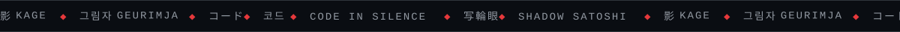
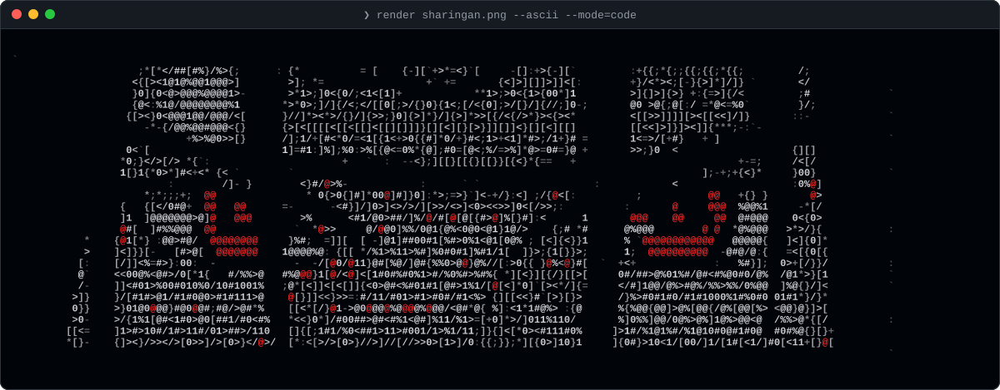

<p align="center">
  
</p>
<p align="center">
  
</p>
<p align="center">
  
</p>

## 👋 About me <sub>自己紹介</sub>



Hi, I'm **Shadow Satoshi**, a developer who likes clean code, quiet focus and shipping things that work. Outside the editor I'm drawn to the culture, language and design of **Japan** 🇯🇵 and **Korea** 🇰🇷, which shape how I think about detail and craft.

> *“Growth occurs when one goes beyond one's limits. Realizing that is also part of training.”*
>
> — **ITACHI UCHIHA** · うちはイタチ

| 日本 | 한국 | `</>` |
|:--|:--|:--|
| Japan · aesthetics & discipline | Korea · culture & language | Code · always learning |

<br clear="right"/>

```ts
const shadow = {
  handle: "ShadowSatoshiii",
  role: "Developer",
  interests: ["日本", "한국", "Anime"],
  motto: "Code in silence. Let the work speak."
};
```

## 🌕 Mindset <sub>月読</sub>

<p align="center">
  
  
</p>

## 👁️ Activity <sub>足跡</sub>

<p align="center">
  
</p>
